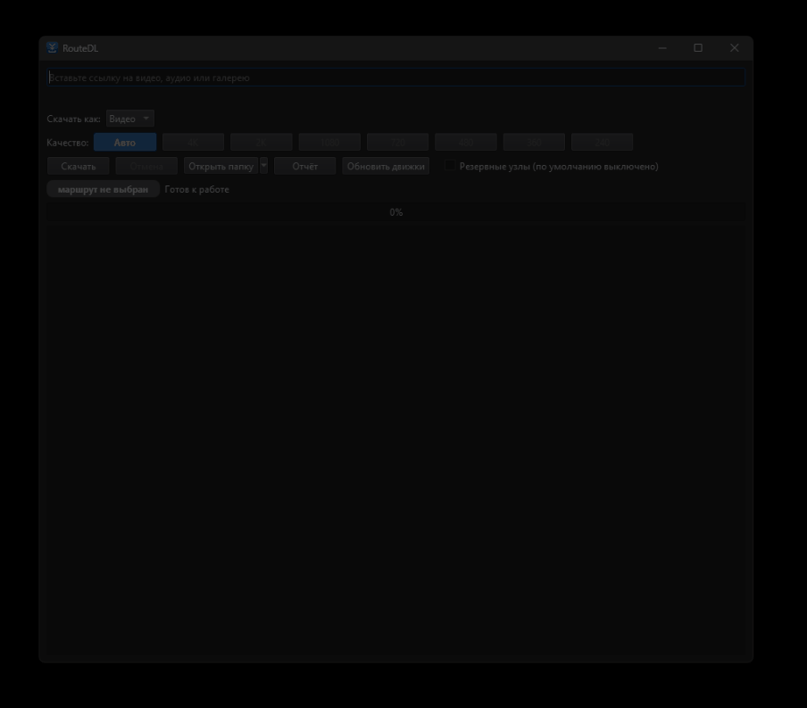

# RouteDL

**English** | [Русский](README.md)



A video, audio and image-gallery downloader that **picks the network route automatically**. It combines [yt-dlp](https://github.com/yt-dlp/yt-dlp) (video/audio), [gallery-dl](https://github.com/mikf/gallery-dl) (galleries) and ffmpeg, and when a site does not open directly it finds a working route **on your own computer, with no third-party servers**.

> **Status: early release (v0.1).** Windows GUI + CLI. License: GPL-3.0.

## Why RouteDL

- **Paste a link, press Download.** No command-line flags, no manual DPI tuning.
- **No admin rights, no kernel driver, no system-wide VPN.** The bypass is a local SOCKS5 proxy on `127.0.0.1` used only by the downloader (powered by [ByeDPI](https://github.com/hufrea/byedpi)).
- **Honest quality picker.** Shows the qualities that are really available (4K down to 240p) and the real source audio format, marked lossy or lossless.
- Video, audio, galleries, playlists (opt-in) and a download queue in one window.

RouteDL does not replace system-wide tools such as zapret. If your system already bypasses a block, RouteDL simply downloads directly: the route ladder always starts with "direct".

## How it works

```
direct --no connection--> local ByeDPI strategy (127.0.0.1)
                              \-- optional (--nodes): backup nodes (xray-core)
```

1. The site is probed directly first (up to 4 s).
2. If that fails, RouteDL tests several ByeDPI strategies in parallel and keeps the one that works for this site.
3. Backup nodes (public, anonymous VLESS lists) are **off by default**. Enable them with `--nodes`, the GUI checkbox, or `"nodes": true` in `routedl.json`. If a site refuses by IP or country and nodes are off, RouteDL says so.

If a site answers but files do not arrive within 45 s, RouteDL moves to the next route instead of waiting. A working route is remembered per site and re-checked starting from "direct" after 3 hours.

## Install (Windows)

1. Download or clone this repository.
2. Double-click `install.bat`. It installs Python 3.12 via winget if missing, then downloads xray, ByeDPI, ffmpeg and deno from their upstream releases (downloads are compared against the tested SHA256 values in `setup_env.ps1`).
3. Double-click `RouteDL.bat`.

Antivirus software may flag `ciadpi.exe` and `xray.exe`, because they are network-bypass tools. Both tested builds showed 0 detections on VirusTotal. Whether to exclude them is your decision.

Manual setup: Python 3.12, `pip install -r requirements.txt`, put `xray.exe`, `ciadpi.exe`, `ffmpeg.exe` and `ffprobe.exe` into `bin\`, and install [Deno](https://deno.com) for YouTube.

## Usage

```
python routedl_gui.py                                   # window
python routedl_cli.py "https://www.youtube.com/watch?v=..."
python routedl_cli.py --quality 720 "https://..."
python routedl_cli.py --audio mp3 --cover "https://..."
python routedl_cli.py --audio best "https://soundcloud.com/..."   # no re-encoding
python routedl_cli.py --playlist "https://www.youtube.com/playlist?list=..."
python routedl_cli.py --report --redact                 # anonymous run report for issues
```

Files go to `downloads\` next to the script. Optional `routedl.json`: `{"downloads": "D:\\Media", "nodes": false}`. The **Update engines** button updates yt-dlp and gallery-dl, since sites break them every 1-3 weeks.

## Limitations

- ByeDPI strategies depend on your ISP and there is no universal one. Tested so far on a single ISP: **testers wanted**.
- A local strategy changes how the connection is made, not the address, so sites that block by IP or country stay blocked. Backup nodes can help, but they are public and anonymous.
- Logins and cookies are intentionally **not supported** (privacy). Age-restricted and private videos will not download.
- Windows only for now. No signed installer yet.

## Help wanted

Run a few downloads, then `python routedl_cli.py --report --redact` (or the **Report** button) and attach the output to an issue. The report contains no links, and with `--redact` domains are replaced by salted hashes.

## Legal

Use RouteDL only for content you have the right to download and in line with the laws of your country and the terms of the sites. Network-bypass tools may be regulated in your jurisdiction; you are responsible for how you use them.

## Credits

yt-dlp (Unlicense), gallery-dl (GPLv2), ByeDPI (MIT), Xray-core (MPL-2.0), FFmpeg (GPLv3 build by gyan.dev), public node lists by igareck. RouteDL is released under GPL-3.0.
